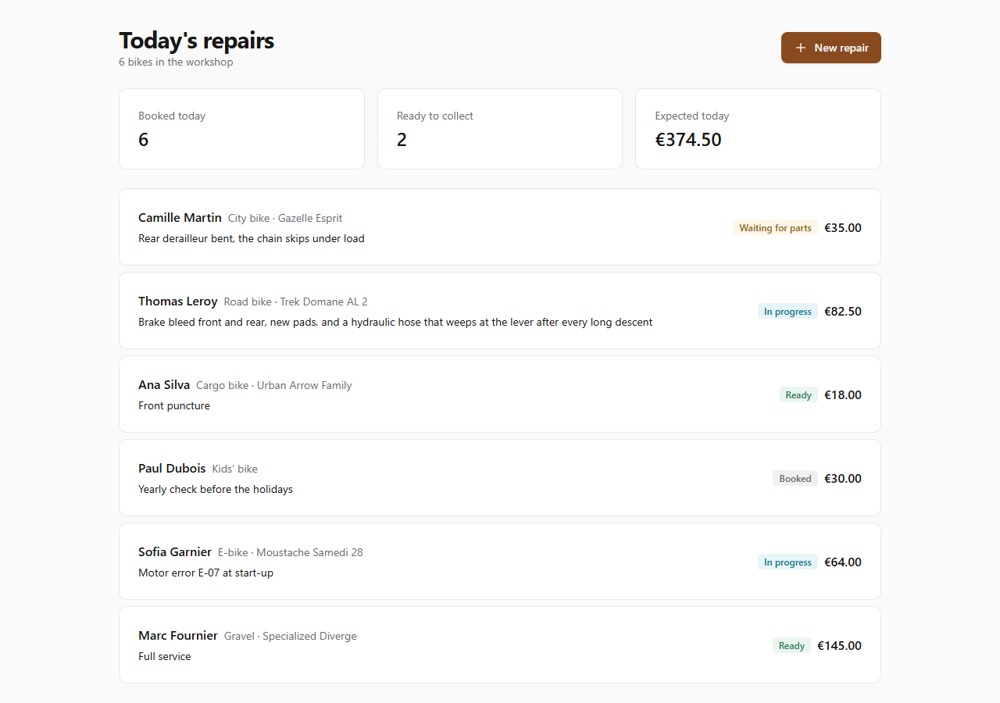

# Bretzel

<p align="center">
  
</p>

> **The mockup is the app.** A Python web framework for building apps with an
> AI agent: ask for a screen, approve a real mockup, and the same file becomes
> the working screen — nothing is redrawn, nothing rewritten. Every file the
> agent writes is checked.

<p align="center">
  <a href="https://bretzel-py.dev/#loop">
    
  </a>
  <br>
  <sub>The whole request: “I run a small bike repair shop. Show me what a screen listing today's repair jobs would look like before you build anything.”</sub>
</p>

Bretzel is for Python developers who build business apps — internal tools,
back offices, dashboards — and want an agent to write them without a JavaScript
stack to run or review. Python owns the state and the interface that follows
it; the browser receives targeted HTML updates through a small runtime: no
React application, no npm pipeline in production.

> **Alpha:** the latest public alpha is `0.1.0a8`. APIs may change between
> alpha releases; only the latest alpha receives fixes.

See it first: [the loop, on the website](https://bretzel-py.dev/#loop) ·
[component gallery](https://ui.bretzel-py.dev) ·
[documentation](https://docs.bretzel-py.dev) ·
[live Kanban](https://demo.bretzel-py.dev) and
[its API](https://demo.bretzel-py.dev/docs).

## Build it with Claude Code

Install the package, then the plugin, from this repository:

```bash
python -m pip install bretzel
claude plugin marketplace add JeanHoccart/bretzel
claude plugin install bretzel@bretzel
```

Then ask for a screen in plain words. Claude first builds a real mockup — a
throwaway Bretzel page on invented data, with the very components and theme
the app will ship — and shows you its screenshots in light and dark. You fix
it in a round or two, then say “Build it”: that same code becomes the
working screen, only where its data comes from changes. Meanwhile it reads the
exact API from `bretzel describe`, and once bretzel is installed in the
project, `bretzel check` runs on every Python file it writes.

## Quickstart, without an agent

Requires Python 3.12, 3.13 or 3.14.

```bash
python -m pip install bretzel
bretzel new hello
cd hello
python -m pip install -e .
bretzel dev
```

Open <http://127.0.0.1:8000>, then edit `app/features/home.py`.

For an existing application:

```bash
bretzel dev my_package.main:app --port 8010
```

## The model

```python
from bretzel import page, refreshable, ui
from bretzel.state import SessionState, field


class Counter(SessionState):
    value: int = field(default=0)


def increment() -> None:
    Counter().value += 1


@refreshable
def count() -> None:
    ui.heading(str(Counter().value))


@page("/", title="Counter")
def home() -> None:
    count()
    ui.button("+1", on_click=increment)
```

A `@refreshable` fragment follows the typed state it reads: when `Counter`
changes, Bretzel renders and ships only that fragment — there is no list of
dependencies to keep in sync. The same redraw reaches the other open
windows the state's scope allows — a `SessionState` stays in its session, an
`AppState` reaches everyone — without polling or subscription code.

<p align="center">
  <a href="https://demo.bretzel-py.dev">
    
  </a>
  <br>
  <sub>One Python app, two windows: drag on the left, the right follows; undo on the right, both follow. No JavaScript written.</sub>
</p>

## What is included

- a Claude Code plugin: the mockup-first workflow and the check on every file;
- typed server and client state;
- more than 100 UI components;
- partial navigation and refreshable fragments;
- realtime updates over SSE;
- signed actions, CSRF protection and security headers;
- OAuth/OIDC doors and signed-cookie identity;
- drag-and-drop with server arbitration;
- server-rendered SVG charts;
- `bretzel describe`, `bretzel check` and browser probes;
- a production wheel containing the readable and minified runtime.

Start with `examples/pomodoro` for a small application, `examples/kanban` for
realtime collaboration, `examples/playground` for the component catalogue and
`examples/docs` for the live reference.

## How it compares

NiceGUI keeps a live server-side UI object tree, Reflex compiles Python into a
React application, and FastHTML stays deliberately close to HTML. Bretzel
instead combines typed state, read by each fragment, with targeted
server-rendered fragments, multi-user updates and 100+ integrated components,
without a Node or Bun build pipeline. Coming from Streamlit or Dash, you keep
the Python-first workflow and gain explicit state with partial updates instead
of reruns or callback wiring. The detailed comparison, with sources:
<https://docs.bretzel-py.dev/compare>.

## Repository

```text
bretzel/             framework source
examples/            complete demonstration applications
tests/               unit, integration and end-to-end suites
```

A bare `pytest` runs the unit and integration suites; `pytest -m e2e` runs the
end-to-end one.

## Production

Run the generated application as a regular ASGI app and provide a private
secret through the environment:

```bash
BRETZEL_MODE=prod BRETZEL_SECRET_KEY="replace-with-a-random-secret" \
  uvicorn app.main:app --host 0.0.0.0 --port 8000
```

See `SECURITY.md` for private vulnerability reports and `CONTRIBUTING.md` for
the development workflow.

## License

MIT — see [`LICENSE`](LICENSE).
